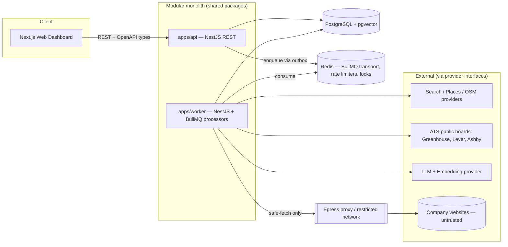
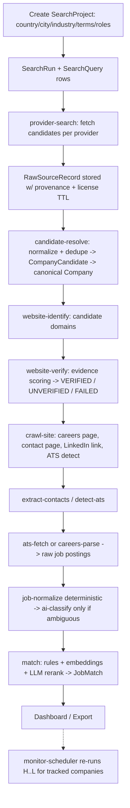
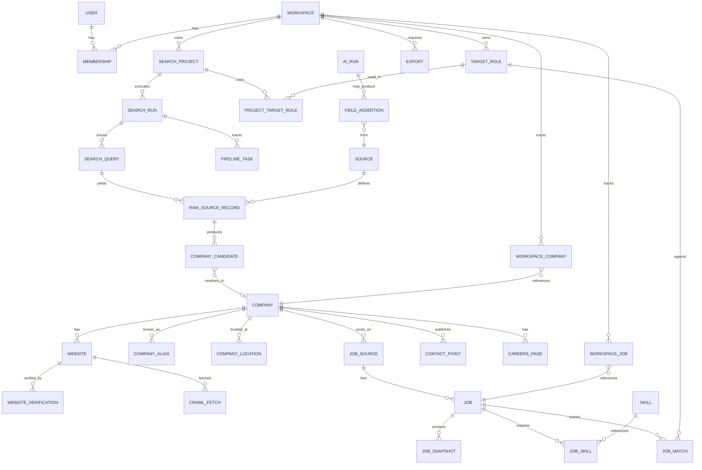

# Company Discovery & Job Intelligence Platform — Architecture Plan

Status: **PROPOSAL — awaiting approval. No implementation has been done.**
Date: 2026-11-24

---

## 1. Current repository assessment

- `C:\Users\Ahtasham\Downloads\Code\Job Finder` is **empty** (no files, not a git repo). There are no conventions to preserve; this is a greenfield setup.
- Local toolchain: Node v24.15.0 ✅, Docker 29.9.3 ✅, Git 2.53 ✅, **pnpm not installed** ❌ (enable via `corepack enable` / `corepack prepare pnpm@latest --activate`).
- Windows 11 dev host: use Docker for Postgres/Redis; keep scripts cross-platform (no bash-only scripts in `package.json`); `.gitattributes` with `eol=lf`.
- Proposed initial setup: `git init`, pnpm workspace, Docker Compose (Postgres 16 + pgvector, Redis 7), shared TS/ESLint config, CI skeleton. Details in §2 and §10.

---

## 2. Recommended monorepo structure

Modular monolith: business modules are **libraries** under `packages/`; `apps/api` and `apps/worker` are two thin composition roots that import the same modules with different wiring (API = HTTP controllers + queue _producers_; worker = queue _processors_). Pure domain logic has zero NestJS/Prisma dependencies so it is trivially unit-testable.

```
/
├─ apps/
│  ├─ web/                  Next.js (App Router), Tailwind, shadcn/ui, TanStack Query/Table
│  ├─ api/                  NestJS REST API (controllers, guards, OpenAPI)
│  └─ worker/               NestJS standalone app (no HTTP), BullMQ processors, schedulers
├─ packages/
│  ├─ contracts/            zod schemas + TS types for REST DTOs, queue payloads, AI outputs (shared by web/api/worker)
│  ├─ domain/               PURE TS: status enums, normalization, dedupe scoring, job/skill normalizers, match scoring
│  ├─ db/                   Prisma schema, migrations, client factory, repository helpers, seed
│  ├─ modules/              NestJS feature modules (each: service, repo, events; no cross-module DB access)
│  │   ├─ workspaces/  ├─ projects/  ├─ discovery/  ├─ companies/  ├─ websites/
│  │   ├─ contacts/    ├─ careers/   ├─ jobs/       ├─ matching/   ├─ exports/  └─ monitoring/
│  ├─ providers/            Provider INTERFACES + adapters (search, places, geocode, ats, llm, embeddings)
│  ├─ safe-fetch/           SSRF-hardened HTTP client, robots.txt, per-domain politeness, content limits
│  ├─ extraction/           Deterministic extractors (JSON-LD, mailto, schema.org JobPosting, ATS detectors)
│  ├─ ai/                   LLM gateway, prompt templates, structured-output validation, injection guards
│  ├─ queue/                Queue names, job-id builders, payload schemas, retry policies, outbox
│  └─ config/               zod-validated env config
├─ tooling/                 eslint-config, tsconfig bases, prettier
├─ docker/                  compose.yml (postgres, redis, mailpit optional), Dockerfiles (api, worker, web)
├─ docs/                    ADRs, this plan, provider terms register
├─ pnpm-workspace.yaml  turbo.json  package.json  .env.example
```

Rules enforced by lint (`eslint-plugin-boundaries` / `dependency-cruiser`):

- `domain`, `contracts` import nothing internal. `modules/*` may import `domain`, `contracts`, `db`, `providers` (interfaces only), but **not** each other's repositories — only each other's public service interface/events.
- Only `providers/*` adapters import vendor SDKs. Only `safe-fetch` performs outbound HTTP to untrusted hosts.

Tooling picks: pnpm workspaces + **Turborepo** (cache, task graph), TypeScript project references, **tsup/SWC** for Nest builds, Vitest (unit), Testcontainers (integration), Playwright (e2e later), OpenAPI generated from zod (`nestjs-zod`) so web uses typed client.

---

## 3. Architecture diagram



Key flow (a discovery project run):



Each arrow is a persisted task row (§8); the stage state lives in PostgreSQL, not in Redis.

---

## 4. Database ER diagram

Principles: (1) **canonical** data (`Company`, `Job`, `Website`, `ContactPoint`) has no `workspace_id`; (2) **workspace-owned** data references canonical rows via join tables (`WorkspaceCompany`, `WorkspaceJob`); (3) every extracted fact has provenance through `FieldAssertion` + `Source`; (4) status enum everywhere: `MISSING | UNVERIFIED | VERIFIED | FAILED` (MISSING = no assertion row exists, rendered explicitly in the UI); (5) UUIDv7 PKs, `created_at/updated_at`, soft-delete only where needed.



Core tables (abridged; not exhaustive):

| Table                                   | Purpose / key columns                                                                                                                                                                                                                                                    |
| --------------------------------------- | ------------------------------------------------------------------------------------------------------------------------------------------------------------------------------------------------------------------------------------------------------------------------ |
| `workspace`, `user`, `membership(role)` | Tenancy. Phase 1 seeds one user + one workspace.                                                                                                                                                                                                                         |
| `search_project`                        | `workspace_id, country, region, city, industry, search_terms[], status, config jsonb`                                                                                                                                                                                    |
| `search_run` / `search_query`           | One execution; per (provider, term, geo, page-cursor) with `status, cursor, attempts, quota_cost` — persisted progress/resume                                                                                                                                            |
| `pipeline_task`                         | **Source of truth for background work**: `type, entity_type, entity_id, idempotency_key UNIQUE, status, attempts, last_error, run_id, available_at`                                                                                                                      |
| `source`                                | Provider/registry row: `provider, terms_url, license, storage_policy, ttl_days, attribution_text`                                                                                                                                                                        |
| `raw_source_record`                     | `source_id, external_id, payload jsonb, fetched_at, expires_at` (purged on TTL when license requires), `UNIQUE(source_id, external_id)`                                                                                                                                  |
| `company_candidate`                     | Preserves incomplete finds: `name_raw, name_norm, domain_hint, city, phone_norm, status(NEW/MERGED/REJECTED/NEEDS_REVIEW), company_id nullable, match_score`                                                                                                             |
| `company`                               | Canonical: `id, display_name, name_norm, country, primary_website_id, merge_state, merged_into_id`                                                                                                                                                                       |
| `company_alias`                         | Alternate names / legal names / former names                                                                                                                                                                                                                             |
| `company_location`                      | `city, address_raw, lat/lng (nullable; TTL-flagged if license limits)`, source link                                                                                                                                                                                      |
| `website`                               | `company_id, origin (scheme+host), registrable_domain, is_primary, verification_status`                                                                                                                                                                                  |
| `website_verification`                  | Evidence rows: `signal(type), weight, evidence_excerpt, source_fetch_id` → aggregated score                                                                                                                                                                              |
| `crawl_fetch`                           | `website_id, url, final_url, status, content_hash, content_type, bytes, fetched_at, robots_allowed, body_ref` (body in object store/compressed column, short retention)                                                                                                  |
| `contact_point`                         | `company_id, kind(EMAIL/PHONE/LINKEDIN/…), value_norm, is_role_mailbox, status, source_fetch_id, evidence_quote` — `UNIQUE(company_id, kind, value_norm)`                                                                                                                |
| `careers_page`                          | `company_id, url, status, detected_platform`                                                                                                                                                                                                                             |
| `job_source`                            | `company_id, platform(GREENHOUSE/LEVER/ASHBY/CUSTOM_HTML/JSONLD), board_token, base_url, last_polled_at`                                                                                                                                                                 |
| `job`                                   | Canonical posting: `job_source_id, external_id, title_raw, title_norm, location_raw, location_norm, workplace_type, employment_type, description_text, apply_url, posted_at, first_seen_at, last_seen_at, closed_at, content_hash`, `UNIQUE(job_source_id, external_id)` |
| `job_snapshot`                          | Change history for monitoring (diff on `content_hash`)                                                                                                                                                                                                                   |
| `skill`, `job_skill`                    | Normalized skill taxonomy + aliases; `job_skill(source = RULE/AI, confidence)`                                                                                                                                                                                           |
| `target_role`                           | Workspace roles + skill sets + synonyms + embedding                                                                                                                                                                                                                      |
| `job_match`                             | `job_id, target_role_id, rule_score, embedding_score, llm_score, final_score, explanation jsonb, algo_version`                                                                                                                                                           |
| `workspace_company`, `workspace_job`    | Workspace-level state: status (new/saved/ignored/applied), notes, tags, `project_id` where discovered                                                                                                                                                                    |
| `field_assertion`                       | Generic provenance: `entity_type, entity_id, field, value jsonb, status, confidence, method(RULE/AI/MANUAL/PROVIDER), source_id, fetch_id, observed_at, expires_at, superseded_by`                                                                                       |
| `ai_run`                                | Model, prompt version, input hash, output (validated JSON), token/cost, validation result                                                                                                                                                                                |
| `export`                                | `format(CSV/XLSX), filter jsonb, status, file_ref, expires_at`                                                                                                                                                                                                           |
| `provider_usage`                        | Per-provider quota/cost ledger (daily/monthly counters)                                                                                                                                                                                                                  |

Dedup strategy (conservative: **never auto-merge on name alone**): deterministic keys first (registrable domain, normalized phone, LinkedIn slug, `(source_id, external_id)`), then fuzzy name (trigram + token set) + same city as _suggestion_; merges at score ≥ high threshold only when ≥ 2 independent signals agree; otherwise `NEEDS_REVIEW`. Merges are reversible (`merged_into_id`, merge audit log).

---

## 5. Module responsibility matrix

| Module                        | Owns (tables)                                                       | Responsibilities                                                           | Depends on                  | Must NOT                                             |
| ----------------------------- | ------------------------------------------------------------------- | -------------------------------------------------------------------------- | --------------------------- | ---------------------------------------------------- |
| workspaces                    | user, workspace, membership                                         | Auth context, workspace scoping, role checks                               | —                           | Know about companies                                 |
| projects                      | search_project, target_role, project_target_role                    | Project CRUD, config validation, run lifecycle API                         | workspaces, discovery       | Call providers directly                              |
| discovery                     | search_run, search_query, source, raw_source_record, provider_usage | Orchestrate provider searches, quotas, cursors, provenance, TTL purge      | providers, queue            | Create canonical companies                           |
| companies                     | company, candidate, alias, location, workspace_company              | Normalization, dedupe, merge/split, canonical records, workspace linking   | domain                      | Fetch websites                                       |
| websites                      | website, website_verification, crawl_fetch                          | Domain identification, ownership verification, safe crawling orchestration | safe-fetch, extraction, ai  | Store contacts/jobs                                  |
| contacts                      | contact_point                                                       | Email/phone/LinkedIn-URL extraction, role-mailbox classification, status   | extraction, websites        | Verify mailboxes by sending mail; fetch linkedin.com |
| careers                       | careers_page, job_source                                            | Careers page discovery, ATS detection                                      | websites, extraction        | Parse jobs                                           |
| jobs                          | job, job_snapshot, skill, job_skill, workspace_job                  | ATS ingestion, HTML/JSON-LD parsing, normalization, change tracking        | careers, providers(ats), ai | Score matches                                        |
| matching                      | job_match                                                           | Hybrid matching, explanations, re-scoring on role edits                    | jobs, ai, domain            | Mutate jobs                                          |
| exports                       | export                                                              | CSV/XLSX generation (streamed), formula-injection sanitising, expiry       | all read APIs               | Query other modules' tables directly                 |
| monitoring                    | (uses pipeline_task)                                                | Schedules re-checks, change detection, notifications (later)               | careers, jobs               | —                                                    |
| provenance (in `db`/`domain`) | field_assertion, ai_run                                             | Assertion write API, status transitions, canonical-value selection         | —                           | —                                                    |
| safe-fetch (pkg)              | —                                                                   | SSRF defence, robots, politeness, limits                                   | —                           | Any DB access                                        |
| ai (pkg)                      | —                                                                   | LLM gateway, schema validation, injection guards, cost caps                | providers(llm)              | Take actions from model output                       |

Cross-module communication: in-process service interfaces + domain events (e.g. `CompanyResolved`, `WebsiteVerified`) written to an **outbox** table, which enqueues the next stage. No cross-module SQL joins in write paths.

---

## 6. Provider integration strategy

### 6.1 Interfaces (in `packages/providers`)

```ts
interface CompanySearchProvider { id; capabilities(); search(q: GeoSearchQuery, cursor?): Promise<Page<RawCompanyRecord>>; terms(): ProviderTerms }
interface PlaceProvider        { findByText(...); getDetails(placeId, fieldMask) }       // lookup-oriented
interface GeocodeProvider      { geocode(text); boundingBox(city, country) }
interface WebSearchProvider    { search(query, opts): Promise<SearchHit[]> }              // for "official website" resolution
interface AtsBoardProvider     { platform; detect(url|html); listJobs(boardToken): Promise<RawJob[]> }
interface LlmProvider          { generateStructured<T>(prompt, schema: ZodType<T>, opts): Promise<T> }
interface EmbeddingProvider    { embed(texts: string[]): Promise<number[][]> }
interface ProviderTerms        { storage: 'NONE'|'ID_ONLY'|'TTL'|'PERMANENT'; ttlDays?; attribution?; bulkAllowed: boolean; rateLimit; termsUrl; reviewedAt }
```

Every adapter ships a **`ProviderTerms` declaration** that the framework _enforces_: storage policy → controls what `raw_source_record` / `field_assertion.expires_at` are written; rate limits → Redis token bucket; quotas → `provider_usage` ledger with hard stop; attribution → surfaced in UI/exports. A provider with `bulkAllowed=false` is only invoked in user-initiated, low-volume mode.

### 6.2 Findings from official documentation (checked 2026-11-24)

| Provider                                                                                                         | What official docs say                                                                                                                                                                                                                                | Implication                                                                                                                                                                                                                                                                                                               |
| ---------------------------------------------------------------------------------------------------------------- | ----------------------------------------------------------------------------------------------------------------------------------------------------------------------------------------------------------------------------------------------------- | ------------------------------------------------------------------------------------------------------------------------------------------------------------------------------------------------------------------------------------------------------------------------------------------------------------------------- |
| **Google Places API** ([policies](https://developers.google.com/maps/documentation/places/web-service/policies)) | May not "export, extract, or scrape" content, incl. pre-fetching, indexing, storing, bulk downloading, or **copying and saving business names/addresses**. Place IDs may be stored indefinitely; lat/lng cacheable max 30 days. Attribution required. | ❌ Cannot be a bulk discovery _source of record_. Allowed pattern: store **only `place_id`**, fetch details live for display with attribution. Treat as optional, on-demand enrichment; legal review before use.                                                                                                          |
| **OSM Nominatim public API** ([policy](https://operations.osmfoundation.org/policies/nominatim/))                | Max 1 req/s, must cache, identify app via UA/Referer, **bulk/systematic queries and "downloading all POIs in an area" prohibited** — use planet/extract instead. ODbL share-alike applies.                                                            | Use only for low-volume geocoding of a city name (cached). Not for company discovery.                                                                                                                                                                                                                                     |
| **OSM via Overpass** ([wiki](https://wiki.openstreetmap.org/wiki/Overpass_API))                                  | Public instance: ≤10k queries/day & 1 GB/day (÷100 if regular), identify app, no parallel scripts; recommend self-host/extract for large needs.                                                                                                       | Viable for a city-scoped `office=it`/`craft` style query at low volume; for scale, self-host Overpass on a Geofabrik Pakistan extract (Docker). Data is ODbL: attribute, and have a legal read on share-alike for the derived database. OSM coverage of Pakistani software houses is likely **thin** — expect low recall. |
| **Foursquare Places** (usage guidelines, [AUP](https://foursquare.com/legal/terms/aup/))                         | Pay-as-you-go/sandbox: **no caching permitted**; enterprise: ≤24 h local-device cache only; no bulk/region-wide pulls; attribution required.                                                                                                          | ❌ Incompatible with persisted discovery unless a negotiated data licence exists. Treat as on-demand lookup at most.                                                                                                                                                                                                      |
| **Brave Search API** ([terms](https://api-dashboard.search.brave.com/terms-of-service))                          | Terms (last updated Feb 2026 per search result) bar storing/caching/building a database of results except transient operational storage, unless on a plan with **storage rights**. Third-party sources disagree on pricing/terms versions.            | If used for website resolution, either pick the storage-rights plan or store only the _outcome you verified from the company's own site_ (the domain + evidence from the crawl), not the search result payload. Confirm current terms before build.                                                                       |
| **Greenhouse Job Board API** ([docs](https://docs.greenhouse.io/job-board.html))                                 | `boards-api.greenhouse.io/v1/boards/{token}/jobs?content=true`; GET needs no auth; "may be rate limited"; no published ToS on that page.                                                                                                              | Good fit: public, structured. Use conservative rate (e.g. ≤1 req/s/host, 1 poll/board/6–24h), honest UA, ETag/`If-Modified-Since` when supported, attribute apply URLs back to source. Confirm ToS wording separately.                                                                                                    |
| **Lever Postings API** ([repo docs](https://github.com/lever/postings-api))                                      | `api.lever.co/v0/postings/{site}` (EU: `api.eu.lever.co`); HTTPS only; read needs no key; docs note published postings are public and may be scraped by third parties; stated rate limit concerns application POSTs.                                  | Good fit. Must try **both global and EU hosts** when probing. Never use the apply POST.                                                                                                                                                                                                                                   |
| **Ashby Public Job Posting API** ([docs](https://developers.ashbyhq.com/docs/public-job-posting-api))            | `GET api.ashbyhq.com/posting-api/job-board/{name}`; returns title, location, address, workplaceType, descriptions, apply URL, optional compensation. Page says nothing on auth/limits/terms.                                                          | Good fit; treat limits as unknown → conservative defaults; re-check developer docs/ToS before enabling in prod.                                                                                                                                                                                                           |
| **LinkedIn** ([User Agreement §8.2](https://www.linkedin.com/legal/user-agreement))                              | Prohibits scrapers, crawlers, bots, bypassing access controls, and copying data from the service. Official data APIs are partner-gated.                                                                                                               | ❌ **No fetching of linkedin.com at all.** Only record a company LinkedIn URL that (a) the company's own website links to (evidence: link on their page), or (b) a user pastes manually. Stored as a URL with provenance; never enriched from LinkedIn.                                                                   |

### 6.3 Practical discovery strategy given those constraints

Because the big POI vendors restrict persistence, **do not make a single vendor the system of record.** Use layered, individually-licensed sources, each behind `CompanySearchProvider`:

1. **User-supplied seeds** — CSV/paste import (zero licensing risk, highest early value).
2. **OSM extract** (self-hosted Overpass or direct `.pbf` import) — ODbL, low recall, free.
3. **Web-search provider for name+domain candidates** — only on a plan whose terms allow the intended storage.
4. **Public directories / industry bodies** (e.g. Pakistani IT association member lists, B2B review directories) — **each requires an individual robots/ToS review**; I have not verified any specific directory's terms. Implement as a plug-in provider only after review.
5. **Google/Foursquare** — optional, `ID_ONLY`/live-lookup mode behind a feature flag, off by default.

Candidate → website resolution: (a) domain hints from the source; (b) web-search provider query `"{name}" {city}`; (c) heuristic domain guesses (only _verified by fetch_, never accepted blindly).

Verification signals (weighted, each stored as `website_verification` evidence): company name in `<title>`/`og:site_name`/JSON-LD `Organization.name`; address/phone/city match; reciprocal link from source listing; contact email domain equals site domain; LinkedIn link present; SSL cert org (weak); WHOIS only if licensed. Threshold → `VERIFIED`; mid → `UNVERIFIED` (kept, flagged); fetch/DNS failure → `FAILED`. AI may help _only_ to compare ambiguous name/entity evidence, with deterministic gate: AI alone can never produce `VERIFIED`.

### 6.4 Hybrid AI policy

- Deterministic first: JSON-LD `JobPosting`/`Organization`, `mailto:`, regexes, ATS URL patterns, title dictionary, skill dictionary + aliases.
- AI only for: ambiguous careers-page-vs-not classification, parsing unstructured HTML job lists, title→role normalization, skill extraction from prose, semantic match rerank.
- All AI calls: JSON schema (zod) validated, retry-once-on-invalid, `quote` fields must be **substring-verifiable** against source text (anti-hallucination), emails/URLs must appear literally in the fetched content, temperature low, per-run cost ceiling, `ai_run` audit row.
- Matching: stage 1 rules (title synonyms, skill overlap) → stage 2 pgvector cosine (embedding provider interface) → stage 3 LLM rerank/explanation only on top-N or borderline. Store `algo_version` for reproducibility.

---

## 7. API design overview

REST, JSON, `/api/v1`, OpenAPI generated from zod, cursor pagination (`?cursor=&limit=`), filter/sort via query params, RFC 7807 problem errors, `Idempotency-Key` header on POST that creates runs/exports. All routes workspace-scoped by auth context (`X-Workspace-Id` or `/workspaces/:id/...`) — never by client-supplied owner fields.

| Area               | Endpoints                                                                                                                                                                                                                                              |
| ------------------ | ------------------------------------------------------------------------------------------------------------------------------------------------------------------------------------------------------------------------------------------------------ |
| Auth/session       | `POST /auth/login`, `POST /auth/logout`, `GET /me` (provider choice in §11)                                                                                                                                                                            |
| Projects           | `GET/POST /projects`, `GET/PATCH/DELETE /projects/:id`, `POST /projects/:id/runs` (start), `GET /projects/:id/runs/:runId` (progress), `POST /runs/:id/cancel`                                                                                         |
| Target roles       | `GET/POST /target-roles`, `PATCH/DELETE /target-roles/:id`                                                                                                                                                                                             |
| Seeds              | `POST /projects/:id/seed-imports` (CSV)                                                                                                                                                                                                                |
| Companies          | `GET /companies` (filters: project, city, status, hasCareers, hasEmail, verification), `GET /companies/:id` (incl. contacts, websites, provenance), `PATCH /companies/:id/workspace-state`, `POST /companies/:id/merge`, `POST /companies/:id/recheck` |
| Candidates         | `GET /candidates?status=NEEDS_REVIEW`, `POST /candidates/:id/resolve`                                                                                                                                                                                  |
| Jobs               | `GET /jobs` (filters: role, match score, company, location, workplace, postedAfter, skill), `GET /jobs/:id`, `PATCH /jobs/:id/workspace-state`                                                                                                         |
| Matches            | `GET /jobs/:id/matches`, `POST /target-roles/:id/rematch`                                                                                                                                                                                              |
| Provenance         | `GET /entities/:type/:id/assertions` (why do we believe this field?)                                                                                                                                                                                   |
| Exports            | `POST /exports` (`format`, `filter`), `GET /exports/:id`, `GET /exports/:id/download` (short-lived signed URL)                                                                                                                                         |
| Ops                | `GET /health`, `GET /ready`, `GET /admin/queues` (read-only stats, admin only), `GET /providers/usage`                                                                                                                                                 |
| Monitoring (later) | `POST /companies/:id/watch`, `GET /changes`                                                                                                                                                                                                            |

Run progress endpoint returns per-stage counts from `pipeline_task` (queued/running/succeeded/failed) so the UI never polls Redis. Web uses TanStack Query (polling → SSE later) and TanStack Table with server-side pagination/sort/filter.

---

## 8. Queue architecture

**Principle: PostgreSQL is the source of truth; BullMQ is a delivery mechanism.** Every unit of work is a `pipeline_task` row with a unique `idempotency_key`; the outbox publisher enqueues it with `jobId = idempotency_key`. If Redis is wiped, a reconciler re-enqueues all `PENDING/RUNNING-stale` tasks. Redis runs with AOF and `maxmemory-policy noeviction`.

| Queue              | Concurrency / limits                                               | Work                                                               | Idempotency key                                   |
| ------------------ | ------------------------------------------------------------------ | ------------------------------------------------------------------ | ------------------------------------------------- |
| `discovery.search` | per-provider limiter (token bucket)                                | Execute one `search_query` page, persist cursor, enqueue next page | `search:{queryId}:{cursor}`                       |
| `company.resolve`  | moderate                                                           | Normalize + dedupe candidate → canonical company                   | `resolve:{candidateId}`                           |
| `website.identify` | moderate                                                           | Find candidate domains (web search / hints)                        | `identify:{companyId}:{v}`                        |
| `website.verify`   | low                                                                | Fetch homepage + score evidence                                    | `verify:{websiteId}:{v}`                          |
| `crawl.site`       | **per-domain concurrency 1, global cap**, politeness delay, robots | Bounded crawl: home, /contact, /about, /careers, sitemap hints     | `crawl:{websiteId}:{depth}:{epoch}`               |
| `extract.contacts` | CPU-bound                                                          | Deterministic contact extraction from stored fetches               | `contacts:{fetchId}`                              |
| `careers.detect`   | low                                                                | Careers URL + ATS platform detection                               | `careers:{companyId}:{v}`                         |
| `jobs.ingest`      | per-ATS-host limiter                                               | Pull ATS board / parse HTML                                        | `jobs:{jobSourceId}:{epoch}`                      |
| `jobs.normalize`   | moderate                                                           | Deterministic normalization; mark ambiguous                        | `jnorm:{jobId}:{contentHash}`                     |
| `ai.classify`      | global LLM concurrency + cost budget                               | Ambiguous cases only                                               | `ai:{kind}:{inputHash}` (also an AI result cache) |
| `match.score`      | moderate                                                           | Role×job scoring                                                   | `match:{jobId}:{roleId}:{algoVer}`                |
| `export.generate`  | low                                                                | Stream CSV/XLSX                                                    | `export:{exportId}`                               |
| `monitor.tick`     | repeatable job                                                     | Select due companies, enqueue recheck                              | `tick:{bucket}`                                   |

Cross-cutting: exponential backoff + jitter; error classification (`RETRYABLE` network/429/5xx, `PERMANENT` 4xx/blocked/robots → `FAILED` status w/ reason, not retried); `Retry-After` honoured; stalled-job detection; poison job → failed set + `pipeline_task.status=FAILED` + visible in dashboard; graceful SIGTERM drain; all handlers are _upsert-style_ (unique constraints on outputs) so re-execution is safe; fan-out via task rows rather than BullMQ flows (avoids state hidden in Redis). Worker scaled by queue group (separate processes later for `crawl.*` with locked-down network).

Progress persistence: `search_run.status` + counters are updated by task completion in the same transaction as the task status; resume = re-enqueue incomplete tasks.

---

## 9. Security risk register

L = likelihood, I = impact (H/M/L).

| #   | Risk                                                                                            | L   | I   | Mitigation                                                                                                                                                                                                                                                                                                                                                                                                                      |
| --- | ----------------------------------------------------------------------------------------------- | --- | --- | ------------------------------------------------------------------------------------------------------------------------------------------------------------------------------------------------------------------------------------------------------------------------------------------------------------------------------------------------------------------------------------------------------------------------------- |
| 1   | **SSRF** via company URLs / redirects reaching internal services or cloud metadata              | H   | H   | `safe-fetch` only: http/https only; ports 80/443 (allow-list); resolve DNS ourselves, reject loopback/private/link-local/CGNAT/ULA/multicast/metadata (169.254.169.254, `fd00::/8` etc.), IPv4-mapped IPv6, decimal/octal IP forms; connect **to the validated IP** (custom undici `connect.lookup`) with original `Host`/SNI; re-validate on **every redirect hop**, max 5; no credentials in URL; deny `file:`/`gopher:` etc. |
| 2   | **DNS rebinding** (TOCTOU between check and connect)                                            | M   | H   | Pin resolved IP for the connection (above); short TTL ignored; re-resolve per request; egress network policy/proxy at container level as defence in depth (worker crawl network has no route to Postgres/Redis/host subnets).                                                                                                                                                                                                   |
| 3   | Unsafe redirects (open-redirect to internal, scheme downgrade, cross-domain to unrelated sites) | M   | M   | Redirect cap, per-hop validation, record `final_url`; verification requires registrable-domain consistency rules; don't carry cookies/auth.                                                                                                                                                                                                                                                                                     |
| 4   | **Prompt injection** from website/job content                                                   | H   | M   | Content is _data_: delimited, system prompt states it is untrusted; **no tools/actions** in extraction calls; output restricted to zod schema; evidence must be substring of source; AI cannot set `VERIFIED` alone; no AI-generated URLs fetched without passing safe-fetch + allow rules; strip hidden text (CSS-hidden, zero-width, HTML comments) before sending.                                                           |
| 5   | Hallucinated companies/emails/jobs                                                              | M   | H   | Deterministic-first; literal-presence checks; assertions require `source_id`/evidence; UI shows status and provenance; never fabricate fallbacks (`MISSING` stays missing).                                                                                                                                                                                                                                                     |
| 6   | Crawler resource exhaustion (huge/slow/infinite responses, gzip bombs, crawl traps)             | H   | M   | Timeouts (connect/total), max bytes (e.g. 2 MB), max decompressed ratio, content-type allow-list, depth/page caps per domain, URL normalization + dedupe, per-domain concurrency.                                                                                                                                                                                                                                               |
| 7   | ToS / licensing violations (Google/Foursquare/Brave storage, LinkedIn scraping)                 | M   | H   | `ProviderTerms` enforced in code; TTL purge job; no linkedin.com fetch (denylist in `safe-fetch`); provider terms register in `docs/` with `reviewedAt`; feature flags default-off for restrictive providers.                                                                                                                                                                                                                   |
| 8   | robots.txt / politeness / being blocked or abusive                                              | M   | M   | Honour robots (cached), identifying UA with contact URL, delays, `Retry-After`, circuit breaker per domain, never bypass CAPTCHAs/WAF.                                                                                                                                                                                                                                                                                          |
| 9   | PII / personal data (emails of named individuals), GDPR/PECA-type exposure                      | M   | H   | Prefer role mailboxes (`hr@`, `careers@`); flag personal-looking addresses; store only publicly published, with source URL + date; retention policy + delete-on-request tooling; no email verification by probing/sending; legal review (see §11).                                                                                                                                                                              |
| 10  | **Tenant data leakage** when multi-user arrives                                                 | M   | H   | `workspace_id` on all workspace-owned tables; repository layer requires `WorkspaceContext`; add Postgres RLS before second user; tests that assert cross-tenant access fails. Canonical tables hold only public data.                                                                                                                                                                                                           |
| 11  | AuthN/AuthZ weaknesses                                                                          | M   | H   | Vetted auth library, secure httpOnly SameSite cookies, CSRF protection, argon2id, rate-limited login, guard-by-default (deny unless `@Public()`), RBAC on membership.                                                                                                                                                                                                                                                           |
| 12  | Secrets leakage (API keys)                                                                      | M   | H   | Env via validated config, never logged; `.env` gitignored; separate keys per env; pre-commit secret scan; redact in logs/AI audit rows.                                                                                                                                                                                                                                                                                         |
| 13  | Stored XSS from scraped content in dashboard                                                    | M   | M   | Render as text; sanitize any HTML (DOMPurify, allow-list) for job descriptions; CSP; never `dangerouslySetInnerHTML` raw.                                                                                                                                                                                                                                                                                                       |
| 14  | CSV/XLSX formula injection                                                                      | M   | M   | Prefix `'` for cells starting `= + - @ \t \r`; XLSX string-typed cells; tested.                                                                                                                                                                                                                                                                                                                                                 |
| 15  | Queue poisoning / replay / Redis exposure                                                       | L   | H   | Redis not published beyond compose network, `requirepass`/ACL in non-dev, payloads zod-validated on consume, size caps, idempotency keys, no code in payloads.                                                                                                                                                                                                                                                                  |
| 16  | Cost/quota runaway (LLM, search API)                                                            | M   | M   | Per-run + daily budgets in `provider_usage`, hard stop & alert, AI cache by input hash, dedupe before enrich.                                                                                                                                                                                                                                                                                                                   |
| 17  | Dependency / supply-chain compromise                                                            | M   | H   | pnpm lockfile + `--frozen-lockfile`, `pnpm audit`/Renovate, minimal deps, `ignore-scripts` for installs where feasible, SBOM later.                                                                                                                                                                                                                                                                                             |
| 18  | SQL injection / mass assignment                                                                 | L   | H   | Prisma parameterized; zod strict DTOs (`.strict()`), raw SQL reviewed (pgvector queries parameterized).                                                                                                                                                                                                                                                                                                                         |
| 19  | Headless-browser risks (if later added for JS-heavy sites)                                      | M   | H   | Defer; if added: isolated container, no network to internal, ephemeral profile, same SSRF controls via proxy, resource caps.                                                                                                                                                                                                                                                                                                    |
| 20  | Log injection / sensitive data in logs                                                          | L   | M   | Structured JSON logging (pino), escape external strings, redact fields.                                                                                                                                                                                                                                                                                                                                                         |
| 21  | Data integrity from bad merges                                                                  | M   | M   | Conservative dedupe, reversible merges, audit log, review queue.                                                                                                                                                                                                                                                                                                                                                                |

---

## 10. Development roadmap with dependencies

| Phase                                        | Deliverables                                                                                                                                                                                                             | Depends on                        | Exit criteria                                                                              |
| -------------------------------------------- | ------------------------------------------------------------------------------------------------------------------------------------------------------------------------------------------------------------------------ | --------------------------------- | ------------------------------------------------------------------------------------------ |
| **0. Foundations**                           | `git init`; pnpm/Turbo workspace; TS/ESLint/Prettier; boundary lint; Docker Compose (Postgres+pgvector, Redis); config package; CI (lint/typecheck/test/build); ADR folder; provider terms register                      | approval                          | `pnpm dev` boots empty api/worker/web; CI green                                            |
| **1. Core data + API skeleton**              | Prisma schema (workspace, projects, source, raw record, candidate, company, field_assertion, pipeline_task), migrations, seed single user/workspace, auth, health, OpenAPI client generation, project + target-role CRUD | 0                                 | CRUD works via web + tests; RLS-ready repo layer                                           |
| **2. Queue backbone**                        | `queue` pkg, outbox publisher, `pipeline_task` lifecycle, reconciler, retry/error taxonomy, rate-limiter + quota ledger, worker bootstrap, run-progress API                                                              | 1                                 | Kill/restart worker mid-run → resumes without duplicates (integration test)                |
| **3. Discovery & dedupe**                    | Provider interfaces; CSV seed provider; OSM provider; web-search provider; normalization; dedupe + review queue; candidate preservation                                                                                  | 2                                 | Lahore project yields candidates with provenance; duplicates merged by deterministic rules |
| **4. Safe crawler**                          | `safe-fetch` (SSRF/rebinding/redirect suite, robots, politeness, limits) with an adversarial test suite                                                                                                                  | 0 (parallelizable with 1–3)       | Red-team tests pass (private IPs, rebinding, redirect chains, bombs)                       |
| **5. Website identification & verification** | Domain resolution, evidence scoring, status model, verification UI                                                                                                                                                       | 3, 4                              | Verified/unverified/failed visible with evidence                                           |
| **6. Contacts + careers + ATS detection**    | Deterministic extractors, role-mailbox classification, LinkedIn URL capture (from company site only), careers discovery, Greenhouse/Lever/Ashby detection                                                                | 5                                 | Fixture-based extractor tests; no linkedin.com requests                                    |
| **7. Jobs ingestion & normalization**        | ATS adapters, JSON-LD/HTML parsing, title/location/skill normalization, snapshots                                                                                                                                        | 6                                 | Idempotent re-ingest; changes tracked                                                      |
| **8. AI layer**                              | LLM gateway, structured outputs, injection guard, cache, cost caps; ambiguous-classification + HTML-job-parse                                                                                                            | 4–7 (can start interface after 2) | Golden-set evals; invalid output rejected                                                  |
| **9. Matching**                              | Rules + embeddings (pgvector) + LLM rerank, explanations, rematch on role change                                                                                                                                         | 7, 8                              | Eval set precision/recall report; reproducible `algo_version`                              |
| **10. Dashboard**                            | Companies/jobs tables (server-side), filters, company detail with provenance, run progress, review queue                                                                                                                 | 1 (skeleton), grows with 3–9      | Usable end-to-end for Lahore example                                                       |
| **11. Exports**                              | Streamed CSV/XLSX, formula-injection sanitising, signed download                                                                                                                                                         | 7                                 | Exports verified in Excel/Sheets; sanitising tests                                         |
| **12. Monitoring**                           | Scheduler, change detection, new-job feed, optional notifications                                                                                                                                                        | 7, 2                              | New posting detected & surfaced; polite polling budgets                                    |
| **13. Multi-user hardening**                 | Invitations, RBAC, Postgres RLS, tenant tests, quotas per workspace                                                                                                                                                      | 1                                 | Cross-tenant test suite green                                                              |

Critical path: 0 → 1 → 2 → 3 → 5 → 6 → 7 → 9 → 10. Phase 4 (crawler) and Phase 10 skeleton can run in parallel with 1–3.

---

## 11. Technical decisions needing clarification

1. **Discovery sources & budget** — Given Google/Foursquare/Brave storage restrictions, are you OK starting with CSV seeds + OSM + a licensed web-search provider? Do you have budget for a storage-rights plan, or a preferred Pakistan-specific directory (each needs its own ToS review)?
2. **Google Places** — Acceptable to use only as live lookup + `place_id` storage (not bulk), or exclude entirely?
3. **LLM & embedding provider** — Which vendor/model for extraction and embeddings (affects pgvector dimension)? Monthly spend ceiling?
4. **Auth** — Single-user now: self-hosted email+password / Auth.js / Better Auth / managed (Clerk)? Preference matters for the later multi-user path.
5. **Legal posture on contact data** — Storing publicly published HR emails: any jurisdictional constraints (Pakistan PECA/data-protection developments, EU/UK GDPR if targeting foreign companies)? I'm not providing legal advice; recommend a quick review before storing at scale.
6. **JS-rendered sites** — Do you need a headless browser at launch? Recommendation: **no**, defer until deterministic + ATS coverage is measured.
7. **Hosting target** (VPS/Docker Compose, Railway/Fly, AWS) — affects egress controls, object storage, and secrets handling.
8. **Raw page retention** — How long to keep fetched HTML (recommendation: 7–30 days, hash + extracted facts kept)? Object storage (S3/MinIO) vs Postgres compressed column?
9. **Dedupe aggressiveness** — Confirm conservative default (auto-merge only with ≥2 independent signals; otherwise review queue).
10. **Verification threshold semantics** — OK that AI can never alone mark a website `VERIFIED`?
11. **Monitoring cadence** — Default poll interval per ATS board (proposal: 12–24 h) and whether notifications (email/Slack) are wanted.
12. **ORM/tenancy** — Prisma + manual workspace scoping now with RLS added in phase 13 (proposed), or RLS from day one (more upfront work, safer)?
13. **Validation stack** — zod end-to-end with `nestjs-zod` (proposed) vs class-validator?
14. **Job scope** — Pakistan-based roles only, or also remote roles posted by Pakistani companies / foreign remote roles? Affects location normalization and matching.
15. **Dev environment** — Install pnpm via Corepack and run everything via Docker Compose + local Node 24? (Node 24 is current; I'd pin an LTS-compatible `engines` range.) Any CI target (GitHub Actions)?
16. **Skill taxonomy** — Start with a curated dictionary (proposed) or import an open taxonomy (e.g. ESCO; license check needed)?
17. **Exports** — Which columns/field provenance should appear in exports? Include verification status columns (proposed)?

---

### Assumptions / caveats

- Provider findings come from the linked official pages as fetched today; several pages don't state ToS or rate limits (Greenhouse, Ashby, Lever read endpoints), so conservative defaults are proposed and these need a pre-production re-check. Brave's current terms version/pricing was **not** confirmed from an authoritative price sheet.
- I have **not** verified the terms of any Pakistan-specific company directory.
- No code, dependencies, or infrastructure were created; only this document.
